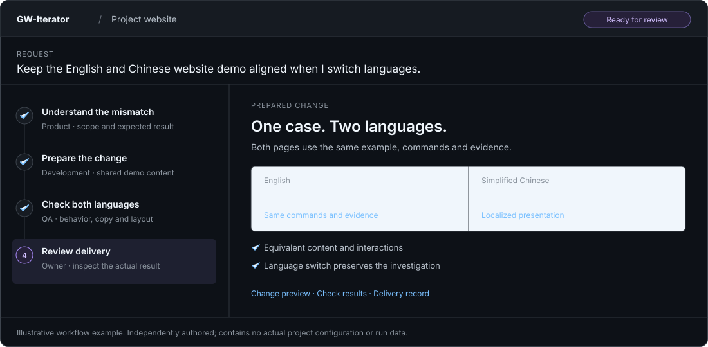

# GW-Iterator

GW-Iterator (GWI) is a local workbench for advancing project work through configurable teams, pipelines and feedback loops. It uses [Multica](https://github.com/multica-ai/multica) for agent execution and keeps project context, dependencies, review, limits and delivery evidence in one interface.

Choose a project, describe an outcome or run a saved pipeline, then follow the steps and activity. Inspect actual changes, return a finding to its owner, and review delivery from evidence. The interface supports English and Simplified Chinese.

[Project website](https://samar1tan.github.io/GW-Iterator/) · [Setup](docs/multica-setup.md) · [Operating guide](docs/operating-guide.md)



*Illustrative workflow example; contains no actual project configuration or run data.*

## Codex directly or through GWI

Codex already supports goals, skills, review and subagents. It provides the reasoning and tools in both routes; GWI adds project-level workflow configuration, supervision and records.

| Work | Codex directly | Through GWI |
| --- | --- | --- |
| Start and adapt | Describe a goal; let Codex plan, delegate and adapt in the conversation. | Describe an outcome for the coordinator to choose existing workflows, or run a saved pipeline directly. Decisions and progress stay recorded. |
| Supervise | Read chat and agent activity, inspect changes, and steer the next action. | Follow named stages, owners, handoffs, artifacts and pending human decisions in one workbench. |
| Check and deliver | Ask Codex for checks/review and follow your project's acceptance and publication process. | Configured verification and human gates organize evidence, revision requests and delivery decisions. |
| Reuse and recover | Reuse instructions and skills; resume or fork a conversation to continue work. | Reuse versioned roles, pipelines and selected knowledge. Keep earlier attempts and check external progress before continuing failed work. |

Use Codex directly for a focused fix or exploration with less setup. Choose GWI when repeatable work needs several handoffs or regular human review. GWI requires local GWI/Multica services and adds coordination/context overhead; faster or cheaper completion still needs measurement.

Native capability references: [Codex goals, review and skills](https://learn.chatgpt.com/docs/app-server#api-overview), [Codex subagents](https://learn.chatgpt.com/docs/agent-configuration/subagents).

## Run locally

Use Node.js 24–26, Git, curl, Docker with Compose, and an authenticated local Codex installation. GitHub operations also need a signed-in `gh` CLI. macOS is the verified native execution platform; other hosts must pass the setup checks.

```sh
npm ci --ignore-scripts
node scripts/setup-multica.mjs
npm run build
npm start
```

Open [the local app](http://127.0.0.1:4318). Connect an existing project through its local workspace. Codex-assisted adoption can propose project guidance and knowledge sources for review. Real project settings and account connections are private local state; this repository contains no populated project configuration.

The [setup guide](docs/multica-setup.md) covers prerequisites, native permission probes, private state and recovery. Use `npm run dev` for frontend development and `npm test` for automated checks.

## Work in a project

- **Workbench** shows current outcomes, pending decisions and delivered artifacts. A general request can coordinate several saved workflows.
- **Pipelines** contains reusable definitions and executions. The visual editor supports dependencies, conditions, human gates, child pipelines and bounded return paths. A focused change starts with implementation, independent QA and delivery review.
- **Team** connects role contracts to actual agents, skills, MCP tools and runtimes. Role changes create revisions; older runs keep their basis.
- **Knowledge** indexes selected documents, artifacts, memory sections and verified lessons with provenance.
- **Settings** holds project bindings and deliberate configuration changes.

Starts and continuations use Codex account availability and recent comparable task trends, without asking for a token estimate. Shared-account observations are ranges, not exact task charges; absent history stays explicit.

GWI waits for human and CI results without repeatedly invoking the model. Execution and outcome completion remain separate. A prepared change does not establish publication: a delivery step must perform and record the required integration or release.

Agent work starts in isolated checkouts of committed source. Development does not silently import the original working directory's dirty files, ignored state or installed dependencies. Review can use a disposable verification copy of the actual prepared changes, including eligible untracked source. Inspect the recorded input, diff and check results before accepting work; the original working directory is not silently overwritten.

State, credentials, knowledge, transcripts and captures are stored under ignored `.local/` directories by default. Selected project context is sent to the configured model provider during agent execution. Services bind to loopback. Codex and GitHub manage their own authentication. Multica is a separately installed dependency with its [own license conditions](THIRD_PARTY_NOTICES.md).

Start with the [pipeline quickstart](docs/pipeline-quickstart.md). See the [operating guide](docs/operating-guide.md), [API reference](docs/API.md), [product requirements](docs/PRD.md) and [integration architecture](docs/architecture/multica-reuse.md).
